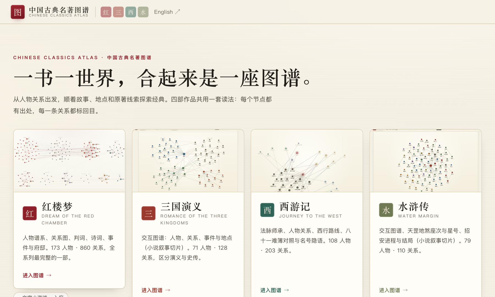
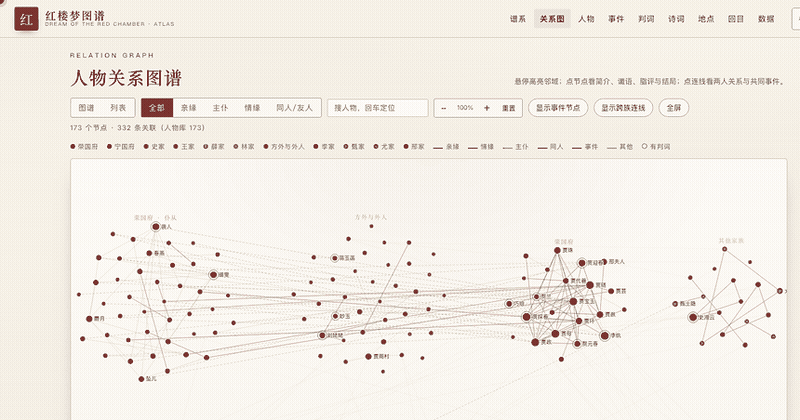
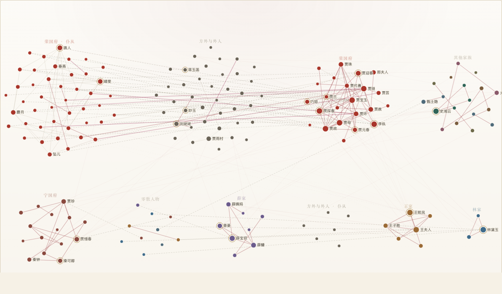
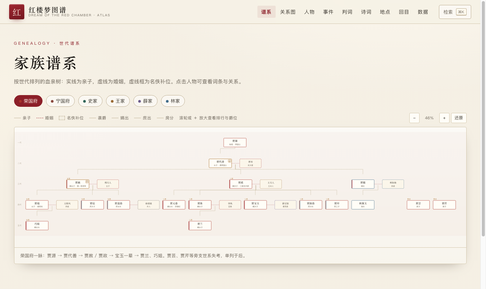
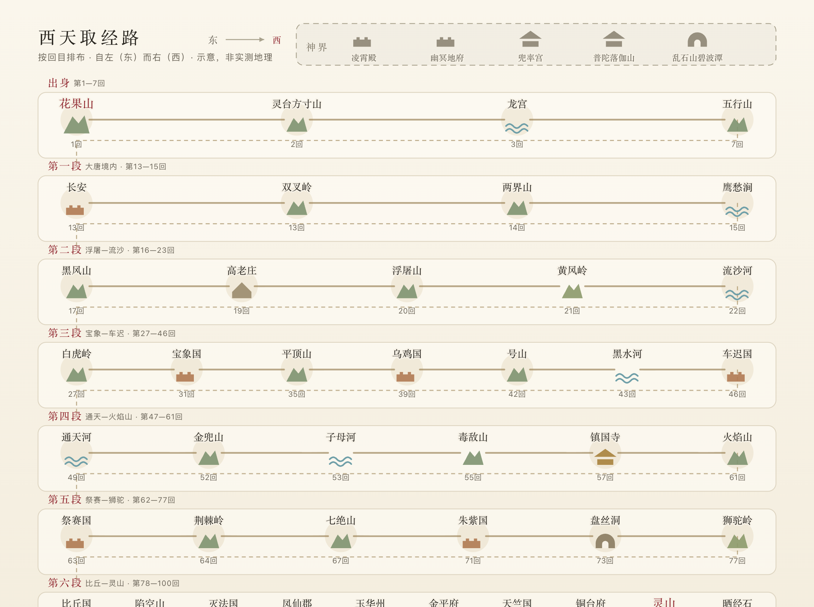
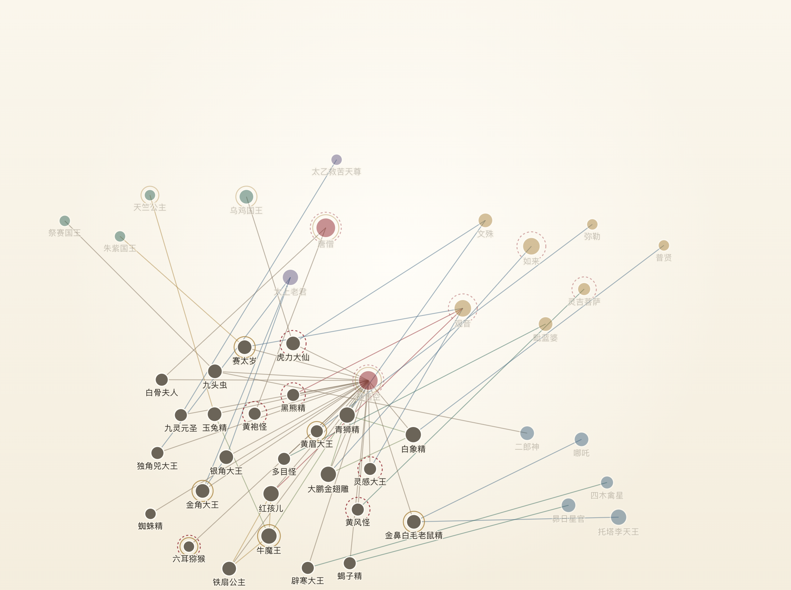
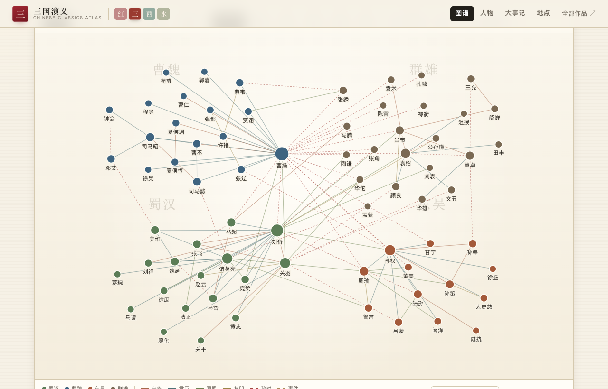

# Chinese Classics Atlas · 中国古典名著图谱

**一个仓库、一个站点，按作品路由组织。** 已收录《红楼梦》《三国演义》《西游记》《水浒传》四部——431 个人物、1301 条带出处的关系；聊斋在后续加入，不预置空页面。架构与作品接入约定见 [docs/architecture.md](docs/architecture.md)。

<p align="center">
  
</p>

<p align="center">
  
</p>

<p align="center">
  <a href="https://iihao.github.io/chinese-classics-atlas/works/honglou/"><b>▶ 红楼图谱（免安装）</b></a>
  &nbsp;·&nbsp;
  <a href="https://iihao.github.io/chinese-classics-atlas/">全部作品</a>
  &nbsp;·&nbsp;
  <a href="https://iihao.github.io/chinese-classics-atlas/works/sanguo/">三国图谱</a>
  &nbsp;·&nbsp;
  <a href="https://iihao.github.io/chinese-classics-atlas/works/xiyou/">西游图谱</a>
  &nbsp;·&nbsp;
  <a href="https://iihao.github.io/chinese-classics-atlas/works/shuihu/">水浒图谱</a>
  &nbsp;·&nbsp;
  <a href="README.en.md">English</a>
  &nbsp;·&nbsp;
  
  
  <a href="https://github.com/iihao/chinese-classics-atlas/stargazers"></a>
</p>

> 把中国古典名著的人物、关系、事件与地点做成可以点、可以搜、可以顺着关系走的图。
> 一个仓库、一个站点，按作品路由组织；纯静态、无需后端、手机可用，前端零依赖。

**如果这个项目对你有帮助，点一个 ⭐ Star 是最好的支持。**

<details>
<summary>三部作品的截图</summary>

**红楼梦** — 人物关系图谱与五族谱系



**西游记** — 西行路线（51 处站点按回目分六段，神界单列）


选「妖魔」界时，本界节点实心、邻界（老君、如来、天庭诸将）自动淡化——一眼看出**妖都有后台**：


**三国演义** — 四势力关系图，每条关系标回目


</details>

## 运行

```bash
python3 tools/build_seed.py      # 红楼：tools/ 数据 → db/seed.json
python3 tools/build_xiyou.py     # 西游：tools/xiyou_data.py → works/xiyou/data.json
python3 tools/build_shuihu.py    # 水浒：tools/shuihu_data.py → works/shuihu/data.json
python3 db/init_db.py --force    # seed.json → SQLite
python3 tools/validate_works.py  # 四部作品的结构与跨引用校验
python3 tools/build_static.py    # 统一构建 dist/
python3 server/app.py            # http://127.0.0.1:8600
```

打开 `http://127.0.0.1:8600` 看系列首页；`/works/honglou/`、`/works/sanguo/`、`/works/xiyou/`、`/works/shuihu/` 分别是四部作品。原有 `/#graph`、`/#item/pl-baoyu` 等红楼分享链接继续有效（从根路径转到红楼）。不要直接双击 `index.html`。

## 作品

| 作品 | 入口 | 当前内容 |
|---|---|---|
| 红楼梦 | `/works/honglou/` | 173 人物 · 860 关系 · 谱系、判词、隐语、诗词、府邸 |
| 三国演义 | `/works/sanguo/` | 试运行切片：71 人物 · 128 关系 · 28 事件 · 21 地点，逐条标注回目 |
| 西游记 | `/works/xiyou/` | 108 人物 · 203 关系 · 56 地点 · 49 事件 · 21 条难簿对照 · 25 条隐语 |
| 水浒传 | `/works/shuihu/` | 79 人物 · 110 关系 · 26 地点 · 14 事件 · 天罡三十六全 + 地煞三十三 · 结局统计 |

### 水浒传切片

水浒的重心不是「谁认识谁」，而是**座次、山头与招安后的结局**：

- **座次表**：天罡三十六全部收录，地煞另选录三十三；每行标星号、绰号、山头与结局，可按山头、
  结局（阵亡 / 病故 / 被害 / 自尽 / 出家 / 归隐 / 存留 / 不明）筛选，点击进人物词条。
- **结局统计**：79 人按结局归类，阵亡 32、存留 13、被害 10、病故 10、归隐 7、出家 4、自尽 2、不明 1。
  招安后折损一目了然。
- **招安进程**：梁山聚义 → 全伙受招安 → 征辽 → 征方腊 → 魂聚蓼儿洼，五个阶段各标回目。
- **交互图谱**：按山头（梁山元老 / 降将公人 / 江湖三山 / 登州 / 揭阳 / 江州 / 大名府 / 清风山 / 庄园故旧）筛选，
  搜姓名、绰号或星号（如「及时雨」）直接定位；点人物看座次、绰号、关系、出场事件与结局。
- **词条档案**：每人补「梁山职司」（依第七十一回职务名单）、绰号释义与上山前身份；有座次者 68 人全部有职司。
  人物卡与详情页显示职司、星号与结局，附维基百科／百度百科检索入口。
- **小说与史**：招安后各本分歧大，金圣叹七十回本止于排座次；宋江之死、《宋史》所载与小说结局不同，
  凡有异说都在词条里注明。
- **边界**：本切片收录主要人物与代表性事件，不是一百单八将全表；地煞按叙事需要选录。

### 西游记切片

六界（取经团队 5 / 西方佛国 13 / 天庭 18 / 仙真有道 8 / 妖魔 41 / 人间 23，共 108 人）的关系图
与红楼同构：图谱/列表双视图、关系类型筛选（师承·亲族·统属·护持·结义·敌对，可与界筛选叠加）、
点连线浮出关系卡（含同一对人物的其余关系与**共同事件**）、全屏、搜索别名定位闪烁、
身份型关系带双向称谓（「弟子」↔「师父」，观音那边看红孩儿是「弟子·善财童子」）。

在此之上，西游做了三块红楼没有对应物的东西：

- **西行路线**：51 处站点按回目分六段排布，自左（东）而右（西）；凌霄殿、兜率宫、落伽山、幽冥地府、
  碧波潭单列「神界」带，不入主线。站点符号按类型区分（山城水洞寺庄），点站点看详情、点主人跳词条。
  坐标不写在数据里，由渲染器按 `(leg, chapter)` 计算——加站点不必重排整条线。
- **难簿对照**：第 99 回八十一难的名目 ↔ 书中实际经过，逐条判定为
  **照应 / 拆分 / 补列 / 存疑**（本页 13 / 3 / 4 / 1）。出身四难全在取经之前、第 100 回为凑足九九补一难，
  都归入「补列」；同回被切成两难的（出城逢虎＋双叉岭上、夜被火烧＋失却袈裟）归入「拆分」。
- **名号隐语**：25 条分七类（拆字·会意、内丹代号、名号反语·游戏、名号寓意、地名寓意、佛典用事、谐音·附会），
  每条必须有 `basis`（回目或正文依据），判定分**通行 / 一说 / 存疑**。
  「唐憎→唐僧」「稀柿衕→西逝」这类牵强读法也收录，但明确标为存疑。

版本口径：唐僧出身故事（陈光蕊、江流儿）在世德堂本被删并，通行本作为第 9 回附录补入，
涉及处一律写「第9回（附录）」；校验器会检查凡提到第 9 回的条目都带「附录」二字。

### 三国演义切片

这是小说叙事切片，范围从桃园结义、官渡、赤壁、夷陵到五丈原；不是全书索引，也不是史实考证。

- **交互图谱**：按蜀汉 / 曹魏 / 东吴 / 群雄筛选，也可按亲缘、君臣、同盟、友朋、敌对筛关系；搜姓名或别号（如「孔明」）直接定位；悬停看邻域，点人物、连线或事件看详情。
- **事件层**：可把 28 个事件作为节点叠加到图上，也可以在大事记中按回次阅读；每个事件列出参与者、地点与回目。
- **地点**：21 处地点附今地对照、回目与发生于此的事件，可与人物、事件互相跳转。
- **回目依据**：每条人物关系、事件和人物词条都标注出处回次；缺依据的内容不收录。
- **小说与史**：桃园结义、草船借箭、空城计、三气周瑜等条目明确标出小说增饰或史传差异，不把演义当史实。
- **百科档案**：39 位人物、28 个事件附生卒、籍贯、官职、交战方、结果等档案字段；每人/每事附维基百科、百度百科外链（事件与地点使用检索链接，避免失效条目）。只取事实线索与链接，不复制百科正文。
- **试运行边界**：目前只覆盖一条代表性叙事线，人物与事件远未穷尽；后续再补官制、势力消长、战役细节与更多史料对照。

## 内容

- **人物 173 条**：主子、妾室、丫鬟、仆役、小厮、清客、僧道、外人，含四大家族、贾府旁支与宁荣两府仆役网络。
- **谱系图注明爵位与身份**：每个节点标出排行（嫡长子 / 庶次女…）、爵位官职（袭荣国公 / 工部员外郎…）、
  房分（长房 / 二房 / 旁支）；承袭爵位者加「爵」角标，嫡出右侧朱条、庶出青灰条，兄弟姊妹按长幼自左向右排列。
- **关系 860 条**：带标签（父子/母女/夫妻/主仆/知己/镜像/魇魔法…），详情页自动把反向关系显示成对应称谓（如宝玉页面显示「父」而非「父子」）。
- **图谱内搜索**：输入姓名或别号（如「蕉下客」）回车，自动恢复全量筛选、居中放大并把该点位闪烁标出。
- **多重关系按权重取主关系**：同一对人物可能既是兄妹又是诗社同人，图上只画一根线并显示权重最高的一条（血缘 > 婚姻 > 主仆 > 诗社发起/社长 > 诗社同人 > 事件关联），其余在关系卡里以「同一对人物另有」并列。
- **地点 29 条**：大观园诸院落、贾府府邸、寺观、外宅等。
- **事件 51 条**：按回次排列，附出场人物与相关回目。
- **回目 64 条**：关键回目提要，与事件双向关联。
- **判词 15 条、诗词 28 条**：判词、十二支曲、葬花吟、芙蓉女儿诔等。
- **隐语 34 条**：谐音、拆字、反语与会意——甄士隐=真事隐、贾雨村=假语村言、元迎探惜=原应叹息、
  单聘仁=善骗人、戴权=带权……每条注明回目与“通行 / 一说 / 存疑”。
- **谶语 → 结局对照 16 条**：判词原文、所谶之事、书中结局、判定（前八十回已应验 / 程高本续书收束 / 诸说存疑），
  存疑条目附学界异说（如黛玉之死的“挂”“埋”之争、熙凤“一从二令三人木”的解法）。
- **府邸示意图**：宁荣二府与大观园的相对方位（街东宁府、街西荣府、园在荣府东北）。
  26 处院落以工笔符号绘制（朱顶为贾母、贾政、凤姐等主子居所，青灰顶为附属与客房），
  标注主人并可跳转词条；另有府墙瓦垄、沁芳溪水系、府门石狮、街面铺装与方向标。
  草木只画书里写过的（潇湘馆竹、栊翠庵松、稻香村杏、紫菱洲柳、蘅芜苑藤、怡红院芭蕉、会芳园梅），
  每处院落附书中文依据，无法可靠定位的景点单独列为“未定位”。
- **谱系 50 个节点**：含 4 个“名佚补位”节点，修正林家、王家、薛家、史家的世系与婚姻关系。
- **参考来源**：360 个词条均附来源，共 820 余条来源项；其中 44 个重点词条附维基百科、百度百科外链（共 88 条）。

## 交互

- **关系图**：连线按亲缘 / 情缘 / 主仆 / 同人 / 事件分类着色（实线、虚线区分），金圈人物有判词。
- **点人物**：弹出简介、谶语（判词原文与释义）、脂评（脂批）、结局，以及关系网与关联事件。
- **点连线**：弹出两人关系（含反向称谓）与两人共同出场/涉及的事件，可继续跳到判词或事件。
- **隐语一栏**：可切换“谐音 · 反语”与“谶语 · 结局对照”，后者按判定统计条数，读的是“预言兑现到什么程度”。
- **府邸一栏**：可只看荣国府 / 宁国府 / 大观园；点院落看主人，图下逐条列出依据回目。

## 数据与来源

`tools/enrich_data.py` 是词条富化数据层，`tools/lore_data.py` 存放谐音、谶语对照与府邸示意图数据，
`tools/build_seed.py` 负责合并、去重、补关系与生成 `db/seed.json`。词条文字为项目自撰，参考了：

- 《红楼梦》（庚辰本、程乙本）回目与原文；
- 冯其庸、李希凡主编《红楼梦大辞典》（文化艺术出版社）；
- 中国艺术研究院红楼梦研究所校注本《红楼梦》（人民文学出版社）；
- 蔡义江《红楼梦诗词曲赋鉴赏》（中华书局）；
- 俞平伯《红楼梦辨》、周汝昌《红楼梦新证》、王昆仑《红楼梦人物论》；
- 余英时《红楼梦的两个世界》、张爱玲《红楼梦魇》等研究著作。

对脂批、版本异文、探佚与“秦学”等有争议的内容，词条中均以“一说”“探佚”
“一家之言”等字样标明，不把推测当作定论。

三国的回目依据《三国演义》通行一百二十回本；史传差异参考《三国志》及裴松之注。
生卒、籍贯、官职等档案字段依史传与通行辞书整理，集中放在 `works/sanguo/encyclopedia.json`；
维基百科、百度百科只作为延伸阅读外链，不抓取或复制其正文。
在线参考链接指向维基百科（CC BY-SA 4.0）与百度百科；项目只取事实线索、
自行撰写词条文字，不直接复制百科原文。

## 结构

```
index.html          系列首页
works/catalog.json  已上线作品目录
works/honglou/      红楼入口（保留原有视图与分享路由）
works/sanguo/       三国切片（data.json 源数据 + encyclopedia.json 百科档案 + 入口页面）
works/xiyou/        西游切片（data.json 由 tools/build_xiyou.py 生成 + 入口页面）
works/shuihu/       水浒切片（data.json 由 tools/build_shuihu.py 生成 + 入口页面）
css/style.css       红楼样式
css/sanguo.css      三国样式
css/xiyou.css       西游样式
css/shuihu.css      水浒样式（座次表、结局标签、招安进程）
js/app.js           红楼前端逻辑（谱系、关系图、词条、检索）
js/works/sanguo.js  三国交互图谱（人物、关系、事件、搜索、详情）
js/works/xiyou.js   西游前端（关系图、西行路线、难簿对照、隐语、人物、行程）
js/works/shuihu.js  水浒前端（关系图、座次表、招安进程、人物、事件、地点）
js/works/honglou-game.js 红楼文字小游戏引擎（状态机、存档、册子）
css/honglou-game.css 红楼文字小游戏样式
works/honglou/game/  红楼文字小游戏入口与剧本 scenes.json
server/app.py       本地 API 与静态文件服务
db/schema.sql       SQLite schema
db/init_db.py       seed.json → SQLite
db/seed.json        生成的数据
tools/build_seed.py 数据构建脚本
tools/build_static.py 统一静态站点构建
tools/sanguo_data.py 合并三国核心数据与百科档案层
tools/xiyou_data.py  西游数据源（人物、关系、路线、难簿、隐语）
tools/build_xiyou.py 西游数据构建与断言
tools/shuihu_data.py  水浒数据源（人物、座次、关系、事件、地点、招安阶段）
tools/build_shuihu.py 水浒数据构建与断言
tools/fetch_wikidata.py Wikidata 事实抓取（CC0，带本地缓存与限速）
tools/wikidata_merge.py 把 Wikidata 事实合并进作品数据
tools/validate_works.py 作品目录与数据校验
tools/validate_game.py 文字小游戏剧本校验（穷举所有路线）
tools/enrich_data.py 词条富化数据
```

## 文字小游戏

红楼有一个第一人称文字小游戏「入府」：<https://iihao.github.io/chinese-classics-atlas/works/honglou/game/>

你扮演新买进荣国府的小丫头，从角门到怡红院，经历两日两夜。七场戏、二十八个选择，
只影响三条暗线（分寸 / 情分 / 风评）与「册子」里记下的话，**不改判词，也不改她们的结局**。
四个去处：留在怡红院、留在账房、出府、调去后院；册子里有十三句话，每一遍只能听见其中几句。
纯静态、无依赖、断网可玩，进度与走到过的结局都存在浏览器本地。

- 入口在系列首页与红楼图谱顶栏；文件为 `works/honglou/game/` + `js/works/honglou-game.js`。
- 剧情全部在 `works/honglou/game/scenes.json`，引擎不写死文本，便于后续给其他作品复用。
- `tools/validate_game.py` 把剧本的所有走法穷举一遍（7936 条路线），确认没有走不到的结局、
  走不到的册子记录和走不到结局的岔路；改剧本后跑一次，CI 里也会跑。

## 外部数据

词条以原著与通行注本为第一依据；外部结构化事实优先取 **Wikidata（CC0）**，只取生卒、职业、职位、
见于何作品等可核对字段，并标注 `source: wikidata`。维基百科条目正文是 CC BY-SA，本项目**不抓取、不转载**，
只把条目或检索页作为延伸阅读链接。

联网环境下可补齐所有作品的外部事实：

```bash
python3 tools/fetch_wikidata.py --work shuihu            # 抓取并缓存到 tools/cache/
python3 tools/fetch_wikidata.py --work shuihu --offline  # 只用缓存
python3 tools/build_shuihu.py                            # 合并进数据包
```

抓取器按中文标签精确匹配实体（不一致则跳过），请求限速 0.4s/次，失败重试；网络不可达时不写文件。
`tools/cache/` 不入库，可断点续跑。当前环境访问 Wikidata 超时，因此仓库里没有抓取结果，
水浒的事实字段来自第七十一回职司名单与通行本整理，已在界面注明。

## 贡献

见 [CONTRIBUTING.md](CONTRIBUTING.md)：新增人物、关系、事件、谱系的写法与提交前自检。

## 许可

代码以 **MIT** 许可开源，见 [LICENSE](LICENSE)。

《红楼梦》《三国演义》《西游记》《水浒传》原文均已进入公有领域；本库的提要、评析、结构数据为项目自撰，
判词、诗词取通行本文字（程乙本为主），参考书目见各条目 `refs` 字段。

## 参与

- 数据在 `tools/build_seed.py` 与 `tools/enrich_data.py`，改完重建即可：
  ```bash
  python3 tools/build_seed.py && python3 db/init_db.py --force
  ```
- 新增人物请同时补关系与谱系；事件请补 `cast`，不要只写正文。
- 提交前建议跑一遍：`python3 -c "import json;json.load(open('db/seed.json'))"` 确认格式。

## 支持这个项目

如果它帮你省下了翻书查人的时间，点一个 **⭐ Star** 能让更多读红楼的人看到它。

- 把它分享给一个正在读原著的朋友
- 发现人物、判词或脂评有误，提一个 Issue
- 想补充数据（人物、事件、判词），欢迎 PR，格式见 `CONTRIBUTING.md`
